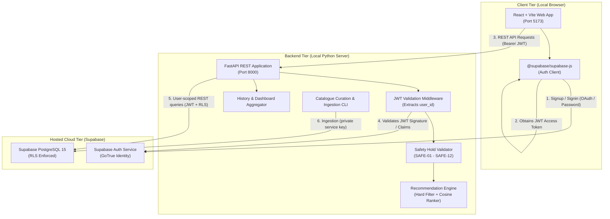
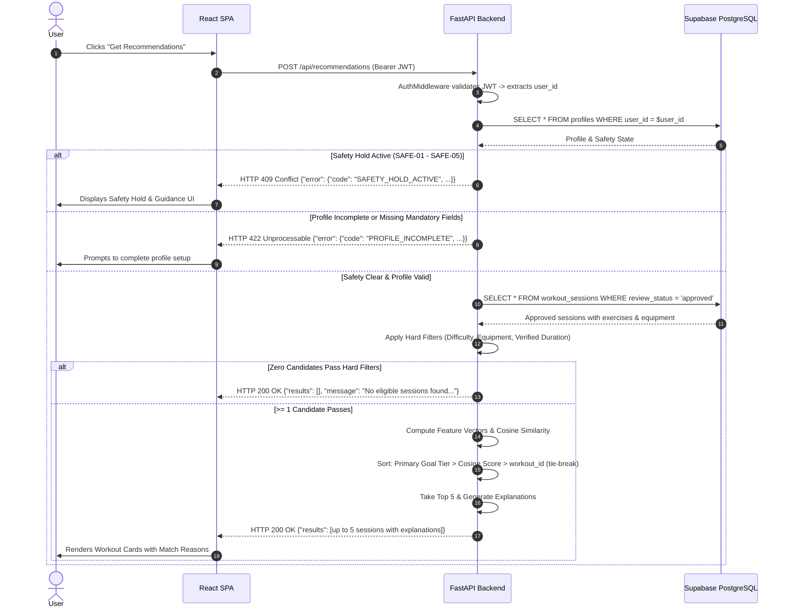

# ARCHITECTURE.md — System Architecture & Component Specification

**Project:** Personalized AI-Driven Fitness and Workout Recommendation System Using Machine Learning  
**Version:** 1.0.0  
**Status:** CONFIRMED & PROPOSED Architectural Baseline  
**Authority Sources:** [SRS.md](../SRS.md) §2, §6, §12; [PRD.md](../PRD.md) §10, §15, §22  

---

## 1. Architectural Goals & Constraints

### 1.1 Architectural Goals
1. **Safety Enforcement Guarantee:** Physical safety screening holds must be enforced at the backend service layer prior to running recommendation algorithms. The frontend UI is treated as untrusted.
2. **Deterministic Recommendation Pipeline:** Hard eligibility constraints (difficulty, equipment, data validity, safety state) must filter candidate sessions prior to machine learning ranking. Results must be strictly reproducible given identical profiles, catalogue version, and ranking configuration.
3. **Transparent Explanations:** Recommendations must include factual, data-backed reasons for suitability (e.g., matching primary goal, compatible difficulty level, available equipment confirmed, duration fit).
4. **Clean Boundary Separation:** A decoupled single-page application (React + Vite) communicating over standardized JSON HTTP REST interfaces to a Python FastAPI service, backed by hosted Supabase Auth and PostgreSQL.
5. **Academic & Demonstration Feasibility:** Local execution for web client and backend API, connected to cloud-managed Supabase PostgreSQL and Supabase Auth. Target p95 pipeline latency < 1.0 second on local development hardware.

### 1.2 Key Constraints
- **Recommendation Unit:** Recommends complete workout sessions (`workout_sessions` composed of ordered `session_exercises`), never disconnected exercises.
- **No Arbitrary Relaxation:** When fewer than 5 or 0 sessions qualify, the engine returns qualifying items or an empty list with an explanatory message; it never loosens hard filters.
- **Service Secret Isolation:** The Supabase service-role key stays in Supabase-managed Edge Function secrets and never reaches the browser or normal FastAPI runtime.
- **No Autonomous Agents / No MCP:** The MVP uses a deterministic ML content-based cosine similarity model in FastAPI; autonomous agents and MCP protocols are deliberately out of scope for MVP.

---

## 2. High-Level System Overview & Topology

---

## 3. Component & Module Responsibilities

### 3.1 Client Tier (React + Vite SPA)
- **Technology:** React 18, Vite, TypeScript/JavaScript, Tailwind CSS, Lucide Icons, `@supabase/supabase-js`.
- **Responsibilities:**
  - Direct authentication interactions with Supabase Auth (Sign Up, Sign In, Sign Out, Session Persistence).
  - Collects and validates client-side input for the 5 mandatory profile attributes: primary goal, fitness level, explicit equipment set, duration, and safety screening.
  - Displays recommendation cards, verified explanations, duration cautions, session exercise sequences, rest timers, and completion controls.
  - Renders dashboard analytics (completion totals, recent activity, weekly trend charts, goal-wise breakdown).
  - Deliberate account deletion dialog with confirmation gating.
- **Boundary Rule:** UI never evaluates safety holds or equipment compatibility authoritatively; all decisions are driven by backend API responses.

### 3.2 Backend Service Tier (FastAPI Application)
- **Technology:** Python 3.10+, FastAPI, Pydantic v2, Uvicorn, NumPy (Cosine Similarity), Supabase Python SDK.
- **Responsibilities:**
  - **Auth Middleware (`app.core.auth`):** Validates incoming `Authorization: Bearer <JWT>` with Supabase Auth `get_user(token)`; derives authoritative `user_id`.
  - **Profile & Safety Service (`app.services.profile`):** Reads/persists profile data in `profiles` table. Evaluates physical screening inputs. Sets or releases safety holds based on explicit user confirmation.
  - **Catalogue & Filter Service (`app.services.catalogue`):** Queries approved, valid sessions from `workout_sessions` and `exercises`. Executes hard eligibility filters:
    1. User level vs session difficulty (Beginner $\to$ Beginner; Intermediate $\to$ Beginner + Intermediate; Advanced $\to$ All).
    2. Available equipment vs session required equipment (with validated mapped alternatives from `exercise_alternatives`).
    3. Verified duration check (session duration must be verified > 0).
  - **Recommendation Service (`app.services.recommender`):**
    - Converts eligible sessions and user preferences into normalized multidimensional feature vectors.
    - Computes Cosine Similarity scores.
    - Ranks primary-goal matches strictly ahead of secondary-goal matches.
    - Sorts by cosine score, applying soft-preference duration warnings.
    - Deterministic tie-break using `workout_id`.
    - Truncates to top 5 items.
  - **History & Analytics Service (`app.services.history`):** Handles explicit completion records, duplicate prevention, and computes aggregated metrics for the dashboard.
  - **Account Lifecycle Service (`app.services.account`):** Calls the JWT-protected `delete-account` Edge Function; deleting the Auth identity cascades to private rows.

### 3.3 Data Tier (Hosted Supabase PostgreSQL)
- **Responsibilities:**
  - Relational schema enforcing foreign keys, unique constraints, and check constraints across the 6 core tables.
  - Row Level Security (RLS) policies guaranteeing that authenticated users can select/update only their own rows in `profiles` and `workout_history`.
  - Shared public read access to approved records in `exercises` and `workout_sessions`.

---

## 4. Component Communication & Data Flow

### 4.1 Recommendation Flow (Sequence Diagram)

---

## 5. Technology Choices and Justifications

| Component | Selected Technology | Status | Justification |
|---|---|---|---|
| Frontend Framework | **React 18 + Vite** | CONFIRMED | Fast local development cycle, native Supabase JS client compatibility, modern state management, standard in industry capstones. |
| Backend Framework | **Python 3.10+ / FastAPI** | CONFIRMED | Native Python ecosystem for machine learning / vector operations (NumPy, Scikit-Learn), asynchronous I/O, automatic OpenAPI documentation. |
| Database & Auth | **Supabase (PostgreSQL 15 + GoTrue)** | CONFIRMED | Managed auth service eliminates custom password hashing and session vulnerabilities; PostgreSQL provides relational integrity and RLS. |
| ML Recommendation Model | **Content-Based Cosine Similarity** | CONFIRMED | Transparent, explainable, reproducible, operates effectively without massive collaborative filtering user interaction matrices. |
| Baseline Benchmark | **Heuristic Goal-Match Filter** | CONFIRMED | Same hard filters + primary goal sorting isolates the ranking value of Cosine Similarity; evaluated via NDCG@5. |
| Persistence Access | **Supabase Data API** | IMPLEMENTED | User JWT is forwarded on reads and writes so PostgreSQL RLS enforces ownership; no database password is needed by the API. |

---

## 6. Authentication & Security Architecture

1. **Token Flow & Validation:**
   - React app signs in directly through `@supabase/supabase-js`, receiving a cryptographically signed JWT.
   - React sends `Authorization: Bearer <JWT>` to FastAPI on all `/api/*` endpoints (except `/api/health`).
   - FastAPI validates the bearer token with Supabase Auth `get_user(token)` and fails closed if Auth is unconfigured or unavailable.
   - User identity comes from the verified Supabase Auth response. Request bodies or query parameters cannot specify `user_id`.
2. **Row Level Security (RLS):**
   - Tables containing private user data (`profiles`, `workout_history`) have RLS enabled.
   - Policies enforce `auth.uid() = user_id`.
   - Shared tables (`exercises`, `workout_sessions`, `session_exercises`, `exercise_alternatives`) allow `SELECT` for authenticated users where `review_status = 'approved'`.
3. **Service Role Isolation:**
   - Account deletion runs in the JWT-protected `delete-account` Edge Function; the service role key stays in Supabase-managed function secrets.
   - API database transactions set the authenticated role and verified user claim so PostgreSQL RLS applies to user data.
   - Never exposed in frontend Vite build or client environment variables.
4. **CORS Policy:**
   - FastAPI configures `CORSMiddleware` with explicitly whitelisted local origins (`http://localhost:5173`, `http://127.0.0.1:5173`). Wildcard `*` origins are prohibited.
5. **Information Disclosure Prevention:**
   - Generic standard error envelope. Raw database exceptions, stack traces, and internal IDs are logged server-side and never returned in client HTTP responses.

---

## 7. Failure Handling & Resilience

- **External Dependency Outage:** If Supabase is unreachable, FastAPI traps connection errors and returns HTTP 503 `SERVICE_UNAVAILABLE` with a clean error envelope (`DATABASE_UNAVAILABLE`).
- **Mathematical Singularities in Cosine Similarity:**
  - A zero vector occurs if an eligible session or profile has zero overlapping features in the vector space.
  - The vector calculation routine explicitly verifies `np.linalg.norm(v) > 0`. If norm is 0, similarity is set to `0.0`.
  - Non-finite numbers (`NaN`, `Infinity`) are sanitized before sorting.
- **Empty Recommendation Sets:**
  - Returning an empty list when no sessions match hard constraints is normal business logic, not an error. The API responds with HTTP 200, `"results": []`, and an actionable message (e.g., suggesting expanding equipment selections).
- **Duplicate History Submissions:**
  - Trapped via idempotency check or unique constraint, returning HTTP 200 (if idempotent key matched) or HTTP 409 `DUPLICATE_COMPLETION`.

---

## 8. Scalability & Performance Considerations

- **Catalogue Size:** Curated catalogue contains ~30 approved sessions and ~100–200 exercises.
- **In-Memory Filtering:** For a catalogue of 30–500 sessions, loading approved sessions into backend memory and performing vectorized NumPy cosine operations takes < 10 milliseconds.
- **Latency Budget:**
  - Database fetch (profile & approved sessions): ~20–80 ms.
  - Hard filtering & vector computation: ~5–15 ms.
  - Response serialization: ~5 ms.
  - Total local pipeline latency: well within the **p95 < 1.0 second** requirement.
- **Caching Strategy (PROPOSED):**
  - Cache approved session records in-memory in FastAPI with a short TTL (e.g. 5 minutes) or cache invalidation on catalog update. This eliminates repetitive queries to Supabase on every recommendation call.

---

## 9. Architectural Decisions & Alternatives

| Decision ID | Status | Chosen Approach | Rejected Alternative | Rationale |
|---|---|---|---|---|
| **DEC-ARCH-01** | CONFIRMED | Complete Sessions as Unit | Recommending Individual Exercises | Recommending isolated exercises does not produce safe, structured, time-managed, or balanced workouts. |
| **DEC-ARCH-02** | CONFIRMED | Content-Based Cosine Model | Collaborative Filtering (Matrix Factorization) | Collaborative filtering suffers from severe cold-start issues in capstone/MVP datasets with few initial users. Content-based is explainable and deterministic. |
| **DEC-ARCH-03** | CONFIRMED | Backend Safety Enforcement | Frontend Safety Validation | Client-side validation can be bypassed by inspecting or modifying network traffic; backend enforcement ensures medical/safety integrity. |
| **DEC-ARCH-04** | CONFIRMED | Hybrid Local/Cloud Demo | Full Local Dockerized Stack | Hosted Supabase saves setup overhead for evaluation while React and FastAPI run locally for interactive demonstration. |
