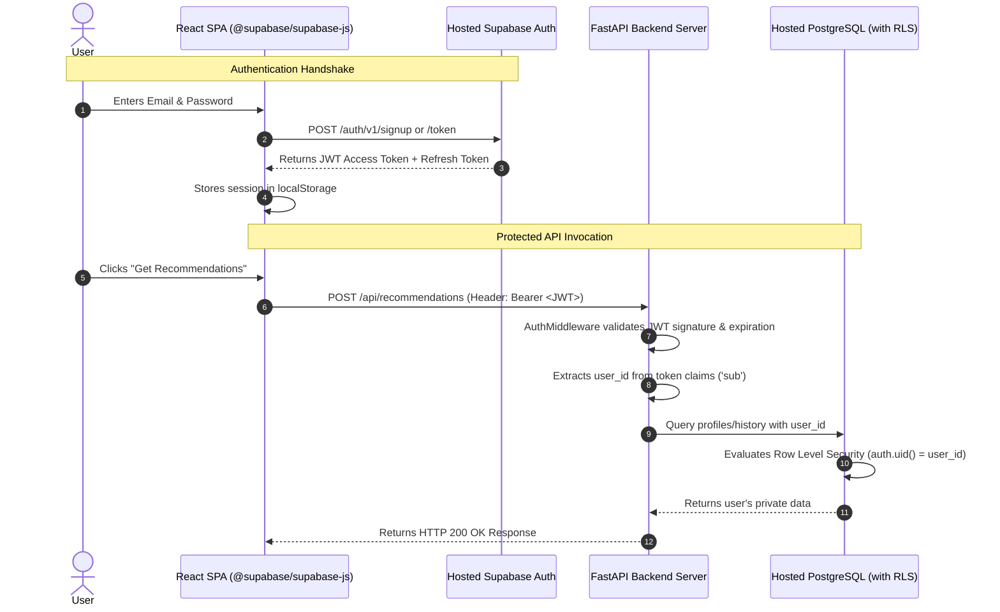
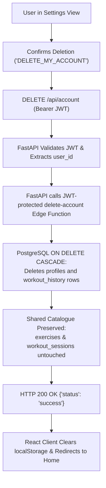

# AUTH.md — Identity, Authentication, Authorization & Security Architecture

**Project:** Personalized AI-Driven Fitness and Workout Recommendation System Using Machine Learning  
**Version:** 1.0.0  
**Status:** CONFIRMED & PROPOSED Auth Baseline  
**Authority Sources:** [SRS.md](../SRS.md) §3.1, §3.11, §7.2, §7.3; [PRD.md](../PRD.md) §14  

---

## 1. Identity Architecture & Authentication Provider

- **Identity Provider:** Hosted **Supabase Auth** (GoTrue engine).
- **Authentication Method:** Email & Password authentication.
- **Email Verification Policy (AUTH-04):** Optional for the MVP; successful signup grants immediate application access to facilitate local demonstration and grading.
- **Token Architecture:**
  - Supabase Auth issues signed JSON Web Tokens (JWT) containing standard claims (`sub` = `user_id`, `exp`, `iat`, `role` = `'authenticated'`).
  - Access tokens are short-lived (default 1 hour); the Supabase JavaScript SDK automatically handles token refresh using persistent refresh tokens stored in browser `localStorage`.

---

## 2. Authentication & Authorization Flow



---

## 3. Server-Side Token Validation (FastAPI)

FastAPI validates the incoming JWT bearer token on every protected endpoint (`AUTH-05`).

- **Token Verification:** FastAPI calls Supabase Auth `get_user(token)` and uses only the verified user ID returned by Auth. Invalid credentials return HTTP 401; missing Auth configuration or an unreachable Auth service returns HTTP 503. No unsigned-token or demo-token fallback is permitted.
- **Identity Derivation (AUTH-07):** The verified Supabase user ID is used for database operations. User IDs supplied in request bodies or query parameters are ignored.
- **Prohibition:** Request bodies, headers, or query parameters cannot provide a `user_id`. Attempting to supply another user's ID is ignored; all queries execute against the token's authenticated `user_id`.

---

## 4. Role & Permission Model

| Role | Definition | Permissions |
|---|---|---|
| **Unauthenticated Visitor** | Public guest accessing landing page | Can read `/api/health`, `/api/nutrition`, and access Supabase signup/login screens. Cannot view profiles, request recommendations, or view history. |
| **Authenticated User** | Standard user registered via Supabase | Can manage own profile/safety state, request personalized recommendations, view approved workout sessions, record own completion history, view own dashboard, and delete own account. |
| **Curator / Administrator** | Developer / Academic evaluator running ingestion scripts | Executes backend curation CLI scripts using `SUPABASE_SERVICE_ROLE_KEY` to validate, review, and approve exercises and workout sessions. |

---

## 5. Row Level Security (RLS) Policies

Row Level Security in Supabase PostgreSQL acts as an independent defense-in-depth authorization boundary (`AUTH-08`, `NFR-SEC-03`).

```sql
-- Profiles Table Policy: Strict ownership
CREATE POLICY "Users can only access own profile" 
ON profiles 
FOR ALL 
TO authenticated 
USING (auth.uid() = user_id) 
WITH CHECK (auth.uid() = user_id);

-- Workout History Table Policy: Strict ownership
CREATE POLICY "Users can only access own history" 
ON workout_history 
FOR ALL 
TO authenticated 
USING (auth.uid() = user_id) 
WITH CHECK (auth.uid() = user_id);

-- Shared Catalogue: Public read-only for approved records
CREATE POLICY "Authenticated users can read approved sessions" 
ON workout_sessions 
FOR SELECT 
TO authenticated 
USING (review_status = 'approved');
```

---

## 6. Account Deletion Workflow (DEL-01 to DEL-07)



---

## 7. Attack Mitigations & Security Controls

1. **Service Role Key Secrecy (`NFR-SEC-04`):**
   - The Supabase service key grants administrative bypass over RLS. It is used only inside the Supabase-managed `delete-account` Edge Function and is never shipped to the frontend or FastAPI configuration.
2. **CORS Hardening (`NFR-SEC-05`, `AT-25`):**
   - FastAPI configures CORS to allow requests strictly from `http://localhost:5173` and `http://127.0.0.1:5173`. Wildcards (`*`) and unknown domains are rejected.
3. **Cross-Site Scripting (XSS) & Token Security:**
   - React's JSX automatically escapes dynamic content rendering.
   - JWT tokens are transmitted via the standard `Authorization` header rather than URL query parameters.
4. **Information Leakage Prevention (`NFR-SEC-07`):**
   - Standardized JSON error envelope strips raw PostgreSQL exception messages and Python tracebacks before sending HTTP responses.
5. **Cross-User Tampering Prevention (`AT-17`):**
   - Tested automatically: User A sending a request with User B's workout ID or history ID cannot read or modify User B's records.
