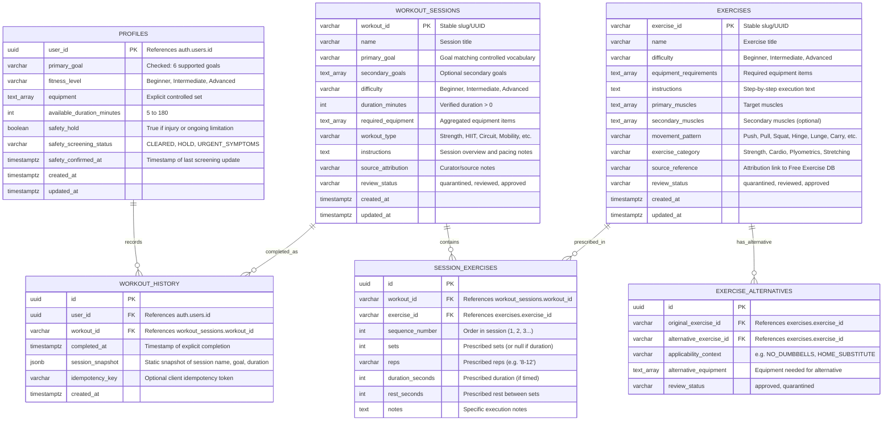

# DATABASE.md — Relational Data Architecture & Persistence Specification

**Project:** Personalized AI-Driven Fitness and Workout Recommendation System Using Machine Learning  
**Version:** 1.0.0  
**Status:** CONFIRMED & PROPOSED Data Model  
**Authority Sources:** [SRS.md](../SRS.md) §5, §11; [PRD.md](../PRD.md) §11, §12, §15, §22  

---

## 1. Selected Database Technology & Ownership

- **Database Engine:** Hosted Supabase PostgreSQL 15.x.
- **Access Model:**
  - **Client Applications (React):** Authenticate via Supabase Auth; direct database queries are restricted by Row Level Security (RLS).
  - **Backend Application (FastAPI):** Uses Supabase Auth for JWT verification and the Data API with the verified user JWT for RLS-scoped persistence.
- **Data Ownership:**
  - *User Data (`profiles`, `workout_history`):* Private to the individual authenticated user (`user_id`). Deleted upon account deletion.
  - *Catalogue Data (`exercises`, `workout_sessions`, `session_exercises`, `exercise_alternatives`):* Shared system assets maintained by administrators/curators. Immutable to regular users; retained permanently regardless of user account deletions.

---

## 2. Entity-Relationship Model



---

## 3. Detailed Data Dictionary & Schema Definitions

### 3.1 Controlled Vocabularies (Enums / Check Constraints)

- **`primary_goal`:** `'Muscle gain'`, `'Fat loss'`, `'Endurance'`, `'General fitness'`, `'Strength improvement'`, `'Flexibility and mobility'`
- **`fitness_level` / `difficulty`:** `'Beginner'`, `'Intermediate'`, `'Advanced'`
- **`equipment` vocabulary:** `'Bodyweight only'`, `'Dumbbells'`, `'Resistance bands'`, `'Barbell'`, `'Bench'`, `'Gym machines'`, `'Kettlebells'`, `'Cable machine'`, `'Exercise ball'`, `'Foam roller'`
- **`review_status`:** `'quarantined'`, `'reviewed'`, `'approved'`
- **`safety_screening_status`:** `'CLEARED'`, `'HOLD'`, `'URGENT_SYMPTOMS'`

---

### 3.2 Illustrative DDL Specifications

```sql
-- Enable UUID extension
CREATE EXTENSION IF NOT EXISTS "uuid-ossp";

-- 1. PROFILES TABLE
CREATE TABLE profiles (
    user_id UUID PRIMARY KEY REFERENCES auth.users(id) ON DELETE CASCADE,
    primary_goal VARCHAR(50) NOT NULL CHECK (primary_goal IN (
        'Muscle gain', 'Fat loss', 'Endurance', 'General fitness', 'Strength improvement', 'Flexibility and mobility'
    )),
    fitness_level VARCHAR(20) NOT NULL CHECK (fitness_level IN ('Beginner', 'Intermediate', 'Advanced')),
    equipment TEXT[] NOT NULL,
    available_duration_minutes INT NOT NULL CHECK (available_duration_minutes BETWEEN 5 AND 180),
    safety_hold BOOLEAN NOT NULL DEFAULT FALSE,
    safety_screening_status VARCHAR(30) NOT NULL DEFAULT 'CLEARED' CHECK (
        safety_screening_status IN ('CLEARED', 'HOLD', 'URGENT_SYMPTOMS')
    ),
    safety_confirmed_at TIMESTAMPTZ,
    created_at TIMESTAMPTZ NOT NULL DEFAULT NOW(),
    updated_at TIMESTAMPTZ NOT NULL DEFAULT NOW(),
    CONSTRAINT chk_equipment_non_empty CHECK (array_length(equipment, 1) > 0)
);

-- 2. EXERCISES TABLE
CREATE TABLE exercises (
    exercise_id VARCHAR(100) PRIMARY KEY,
    name VARCHAR(255) NOT NULL,
    difficulty VARCHAR(20) NOT NULL CHECK (difficulty IN ('Beginner', 'Intermediate', 'Advanced')),
    equipment_requirements TEXT[] NOT NULL DEFAULT '{}',
    instructions TEXT NOT NULL,
    primary_muscles TEXT[] NOT NULL DEFAULT '{}',
    secondary_muscles TEXT[] DEFAULT '{}',
    movement_pattern VARCHAR(50),
    exercise_category VARCHAR(50) NOT NULL,
    source_reference VARCHAR(255) NOT NULL,
    review_status VARCHAR(20) NOT NULL DEFAULT 'quarantined' CHECK (review_status IN ('quarantined', 'reviewed', 'approved')),
    created_at TIMESTAMPTZ NOT NULL DEFAULT NOW(),
    updated_at TIMESTAMPTZ NOT NULL DEFAULT NOW()
);

-- 3. WORKOUT_SESSIONS TABLE
CREATE TABLE workout_sessions (
    workout_id VARCHAR(100) PRIMARY KEY,
    name VARCHAR(255) NOT NULL,
    primary_goal VARCHAR(50) NOT NULL CHECK (primary_goal IN (
        'Muscle gain', 'Fat loss', 'Endurance', 'General fitness', 'Strength improvement', 'Flexibility and mobility'
    )),
    secondary_goals TEXT[] DEFAULT '{}',
    difficulty VARCHAR(20) NOT NULL CHECK (difficulty IN ('Beginner', 'Intermediate', 'Advanced')),
    duration_minutes INT NOT NULL CHECK (duration_minutes > 0),
    required_equipment TEXT[] NOT NULL DEFAULT '{}',
    workout_type VARCHAR(50) NOT NULL,
    instructions TEXT NOT NULL,
    source_attribution VARCHAR(255) NOT NULL,
    review_status VARCHAR(20) NOT NULL DEFAULT 'quarantined' CHECK (review_status IN ('quarantined', 'reviewed', 'approved')),
    created_at TIMESTAMPTZ NOT NULL DEFAULT NOW(),
    updated_at TIMESTAMPTZ NOT NULL DEFAULT NOW()
);

-- 4. SESSION_EXERCISES JOIN TABLE
CREATE TABLE session_exercises (
    id UUID PRIMARY KEY DEFAULT uuid_generate_v4(),
    workout_id VARCHAR(100) NOT NULL REFERENCES workout_sessions(workout_id) ON DELETE CASCADE,
    exercise_id VARCHAR(100) NOT NULL REFERENCES exercises(exercise_id) ON DELETE RESTRICT,
    sequence_number INT NOT NULL CHECK (sequence_number > 0),
    sets INT CHECK (sets > 0),
    reps VARCHAR(50),
    duration_seconds INT CHECK (duration_seconds >= 0),
    rest_seconds INT NOT NULL DEFAULT 60 CHECK (rest_seconds >= 0),
    notes TEXT,
    CONSTRAINT uq_session_sequence UNIQUE (workout_id, sequence_number),
    CONSTRAINT chk_prescription_valid CHECK (
        (sets IS NOT NULL AND reps IS NOT NULL) OR (duration_seconds IS NOT NULL)
    )
);

-- 5. EXERCISE_ALTERNATIVES TABLE
CREATE TABLE exercise_alternatives (
    id UUID PRIMARY KEY DEFAULT uuid_generate_v4(),
    original_exercise_id VARCHAR(100) NOT NULL REFERENCES exercises(exercise_id) ON DELETE CASCADE,
    alternative_exercise_id VARCHAR(100) NOT NULL REFERENCES exercises(exercise_id) ON DELETE CASCADE,
    applicability_context VARCHAR(100) NOT NULL,
    alternative_equipment TEXT[] NOT NULL DEFAULT '{}',
    review_status VARCHAR(20) NOT NULL DEFAULT 'quarantined' CHECK (review_status IN ('quarantined', 'approved')),
    created_at TIMESTAMPTZ NOT NULL DEFAULT NOW(),
    CONSTRAINT uq_exercise_alt UNIQUE (original_exercise_id, alternative_exercise_id, applicability_context)
);

-- 6. WORKOUT_HISTORY TABLE
CREATE TABLE workout_history (
    id UUID PRIMARY KEY DEFAULT uuid_generate_v4(),
    user_id UUID NOT NULL REFERENCES auth.users(id) ON DELETE CASCADE,
    workout_id VARCHAR(100) NOT NULL REFERENCES workout_sessions(workout_id) ON DELETE RESTRICT,
    completed_at TIMESTAMPTZ NOT NULL DEFAULT NOW(),
    session_snapshot JSONB NOT NULL,
    idempotency_key VARCHAR(100),
    created_at TIMESTAMPTZ NOT NULL DEFAULT NOW(),
    CONSTRAINT uq_user_idempotency UNIQUE (user_id, idempotency_key)
);

-- Indexes for performance
CREATE INDEX idx_profiles_user ON profiles(user_id);
CREATE INDEX idx_sessions_approved ON workout_sessions(primary_goal, difficulty) WHERE review_status = 'approved';
CREATE INDEX idx_exercises_approved ON exercises(review_status) WHERE review_status = 'approved';
CREATE INDEX idx_session_exercises_workout ON session_exercises(workout_id, sequence_number);
CREATE INDEX idx_workout_history_user_completed ON workout_history(user_id, completed_at DESC);
```

---

## 4. Row Level Security (RLS) Strategy

Row Level Security is enabled on all tables in the `public` schema.

```sql
-- Enable RLS
ALTER TABLE profiles ENABLE ROW LEVEL SECURITY;
ALTER TABLE workout_history ENABLE ROW LEVEL SECURITY;
ALTER TABLE exercises ENABLE ROW LEVEL SECURITY;
ALTER TABLE workout_sessions ENABLE ROW LEVEL SECURITY;
ALTER TABLE session_exercises ENABLE ROW LEVEL SECURITY;
ALTER TABLE exercise_alternatives ENABLE ROW LEVEL SECURITY;

-- 1. Profiles: Users can only read and update their own profile
CREATE POLICY "Users can manage own profile" ON profiles
    FOR ALL USING (auth.uid() = user_id)
    WITH CHECK (auth.uid() = user_id);

-- 2. Workout History: Users can read and insert their own history
CREATE POLICY "Users can manage own history" ON workout_history
    FOR ALL USING (auth.uid() = user_id)
    WITH CHECK (auth.uid() = user_id);

-- 3. Shared Catalogue: Public/authenticated users can view only APPROVED records
CREATE POLICY "Anyone can read approved exercises" ON exercises
    FOR SELECT USING (review_status = 'approved');

CREATE POLICY "Anyone can read approved sessions" ON workout_sessions
    FOR SELECT USING (review_status = 'approved');

CREATE POLICY "Anyone can read session exercises" ON session_exercises
    FOR SELECT USING (
        EXISTS (
            SELECT 1 FROM workout_sessions ws 
            WHERE ws.workout_id = session_exercises.workout_id AND ws.review_status = 'approved'
        )
    );

CREATE POLICY "Anyone can read approved alternatives" ON exercise_alternatives
    FOR SELECT USING (review_status = 'approved');
```

---

## 5. Data Lifecycle, Sensitive Data & Retention

### 5.1 Account Deletion & Cascading
- When a user confirms account deletion (`DELETE /api/account`):
  1. The backend triggers Supabase Admin `auth.admin.delete_user(user_id)`.
  2. Because `profiles.user_id` and `workout_history.user_id` have `ON DELETE CASCADE` referencing `auth.users(id)`, PostgreSQL automatically and atomically deletes the profile and all history records.
  3. Shared records in `exercises` and `workout_sessions` are unaffected.

### 5.2 Sensitive Data Minimization
- In compliance with **NFR-PRIV-01** and **NFR-PRIV-02**:
  - No detailed medical notes or symptom descriptions are persisted in `profiles`.
  - Only boolean `safety_hold`, status enum (`CLEARED`, `HOLD`, `URGENT_SYMPTOMS`), and confirmation timestamp are stored.
  - No user passwords or credentials are stored in application tables (handled entirely within Supabase GoTrue).

---

## 6. Seed Data & Ingestion Workflow

1. **Source Dataset:** Free Exercise DB (`exercises.json`).
2. **Ingestion Script (`scripts/ingest_catalogue.py`):**
   - Reads source JSON, validates against schema (name, instructions, equipment).
   - Maps raw equipment strings to controlled equipment vocabulary.
   - Inserts into `exercises` with `review_status = 'quarantined'`.
3. **Session Curation:**
   - Workout plans must be authored and reviewed separately; exercise source data does not supply complete workout prescriptions.
   - Link each session to approved exercises with reviewed sequences, sets, reps/duration, and rest intervals.
   - Run `scripts/validate_catalogue.py` to check integrity and goal coverage. Approval remains a reviewer action.
