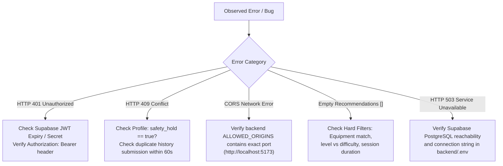

# DEBUGGING.md — Operational Troubleshooting & Diagnostics Guide

**Project:** Personalized AI-Driven Fitness and Workout Recommendation System Using Machine Learning  
**Version:** 1.0.0  
**Status:** PROPOSED Operational Guide  
**Authority Sources:** [SRS.md](../SRS.md) §3.12, §8, §12; [PRD.md](../PRD.md) §17, §20  

---

## 1. Diagnostic Philosophy & Safety Principles

1. **Safety Gating is Not a Bug:** If `POST /api/recommendations` returns HTTP 409 `SAFETY_HOLD_ACTIVE`, the system is operating as designed. Never bypass safety holds in code or database tables to "fix" a test failure.
2. **Never Expose Credentials During Troubleshooting:** Do not print `SUPABASE_SERVICE_ROLE_KEY`, Auth keys, or database connection strings to console logs or browser windows.
3. **Trace with Request IDs:** Protected API errors and server logs emit a unique `request_id` (UUID). Use this identifier to correlate frontend errors with backend server logs.

---

## 2. Root-Cause Analysis Workflow



---

## 3. Common Failure Scenarios & Solutions

### 3.1 Authentication & Authorization Failures

#### Scenario: Client receives HTTP 401 `{"error": {"code": "UNAUTHORIZED", ...}}`
- **Symptom:** API calls fail immediately after login or after some idle time.
- **Root Causes:**
  1. Expired JWT access token.
  2. Supabase Auth URL or public key is missing or points to a different project than the frontend.
  3. Client failed to attach `Authorization: Bearer <token>` header.
- **Diagnostic Steps:**
  1. In browser DevTools $\to$ Network tab, inspect the failed request's headers. Verify `Authorization` exists.
  2. Copy the token into `jwt.io` (without secret) and check the `exp` claim against current epoch time.
  3. Confirm `SUPABASE_URL` and `SUPABASE_ANON_KEY` in `backend/.env` match the frontend project settings.
- **Recovery:** Call `@supabase/supabase-js` `supabase.auth.refreshSession()` on the client or re-authenticate.

---

### 3.2 Safety Hold & Screening Issues

#### Scenario: Recommendations endpoint returns HTTP 409 `SAFETY_HOLD_ACTIVE`
- **Symptom:** User cannot view recommendations despite having configured a valid fitness goal and level.
- **Root Causes:** User checked "Yes" to active injury, ongoing limitation, or current pain during screening (`SAFE-02`, `SAFE-03`).
- **Diagnostic Steps:**
  1. Inspect the profile via `GET /api/profile`. Check values of `safety_hold` and `safety_screening_status`.
- **Resolution:**
  - This is expected protective behavior.
  - To resume, the user must explicitly submit updated screening answers confirming full resolution (`SAFE-08`, `SAFE-09`) via the Profile Settings screen.

---

### 3.3 Recommendation & Filter Discrepancies

#### Scenario: User receives HTTP 200 with `{"results": []}` (Empty Recommendations)
- **Symptom:** No recommendations appear for an authenticated user with a cleared safety screening.
- **Root Causes:**
  1. **Equipment Mismatch:** The user selected an equipment set (e.g. only "Exercise ball") that cannot satisfy any approved workout session.
  2. **Difficulty Constraint:** A Beginner user has selected a goal where all seeded sessions are currently Intermediate or Advanced.
  3. **Unapproved Records:** Seeded sessions have `review_status = 'quarantined'` rather than `'approved'`.
- **Diagnostic Steps:**
  1. Query database: `SELECT workout_id, difficulty, required_equipment, review_status FROM workout_sessions WHERE review_status = 'approved';`.
  2. Check if user's equipment array contains all items in `workout_sessions.required_equipment`.
- **Resolution:** Add appropriate sessions to the approved catalogue or guide user to select realistic equipment (e.g., adding Dumbbells or Bodyweight).

---

### 3.4 Database & Supabase Connectivity

#### Scenario: Backend returns HTTP 503 for Supabase data access
- **Symptom:** FastAPI endpoints fail with `DATABASE_UNAVAILABLE`.
- **Root Causes:**
  1. Supabase project is paused (free tier inactivity).
  2. Network firewall blocks outgoing traffic on port 5432 / 6543.
  3. Confirm `SUPABASE_URL` and the publishable key point to the same active project.
- **Diagnostic Steps:**
  1. Check project status on [app.supabase.com](https://app.supabase.com). If paused, click "Restore".
  2. Test connection with `psql` or PowerShell:
     ```powershell
     Test-NetConnection -ComputerName "db.YOUR_PROJECT_ID.supabase.co" -Port 5432
     ```
  3. Verify port 6543 is used if connecting through the transaction pooler.

---

### 3.5 CORS & Frontend Network Errors

#### Scenario: Browser displays `Access to fetch at ... has been blocked by CORS policy`
- **Symptom:** Network request fails before reaching FastAPI handler.
- **Root Causes:** Frontend is running on an unexpected port (e.g., `5174` instead of `5173`) not listed in `ALLOWED_ORIGINS`.
- **Diagnostic Steps:**
  1. Check browser address bar for current Vite port.
  2. Check `backend/.env` for `ALLOWED_ORIGINS="http://localhost:5173,http://127.0.0.1:5173"`.
- **Resolution:** Add the new origin to `ALLOWED_ORIGINS` and restart FastAPI server.

---

## 4. Diagnostic Logging Configuration

In `backend/app/core/logging.py`, configure structured logging:

```python
import logging
import sys

def setup_logging():
    logging.basicConfig(
        level=logging.INFO,
        format="%(asctime)s [%(levelname)s] [%(name)s] [ReqID: %(request_id)s] %(message)s",
        handlers=[logging.StreamHandler(sys.stdout)]
    )
```

- When reporting issues, always provide:
  1. The `request_id` from the HTTP error envelope.
  2. Backend terminal log lines surrounding the request.
  3. Exact inputs sent in the request body.
