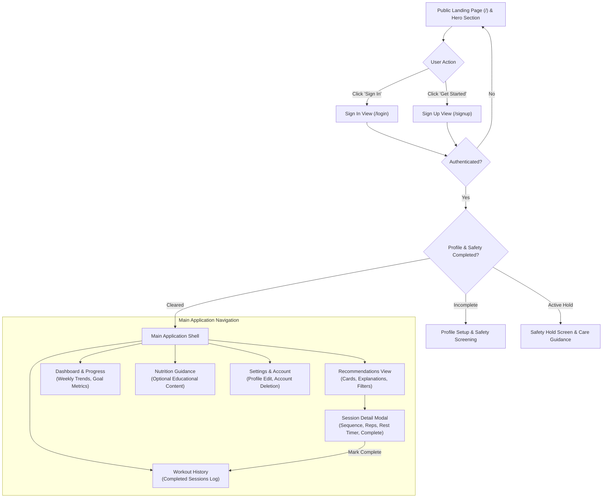

# DESIGN.md — User Experience & Interface Design Specification

**Project:** Personalized AI-Driven Fitness and Workout Recommendation System Using Machine Learning  
**Version:** 1.0.0  
**Status:** PROPOSED UX/UI Specification  
**Authority Sources:** [PRD.md](../PRD.md) §6, §8, §9, §10, §12, §13; [SRS.md](../SRS.md) §3.2, §3.3, §4.1, §7.5  

---

## 1. UX Goals & Design Principles

### 1.1 Core Principles
1. **Safety First, Uncompromising Clarity:** If a user reports pain, active injury, or cardiovascular symptoms, the UI immediately shifts to a supportive, unambiguous Safety Hold state. It never offers dangerous "workarounds" or minimizes symptoms.
2. **Explainable AI & Radical Transparency:** Every recommended workout session displays plain-language, evidence-based reasons explaining why it was selected (goal alignment, difficulty suitability, equipment availability, duration fit). No arbitrary "99% match" black-box badges.
3. **Frictionless Onboarding:** Quick 3-step setup (Goal $\to$ Level/Equipment/Duration $\to$ Physical Safety Screening) without intrusive requests for non-essential biometric data (no forced weight, height, or calorie metrics).
4. **Deliberate Actions:** Logging a workout completion or deleting an account requires an intentional, confirmed user interaction.
5. **Accessible & Responsive:** Built according to WCAG 2.1 AA accessibility standards, high-contrast typography, and fully responsive across mobile, tablet, and desktop viewports.

---

## 2. Information Architecture & Navigation



---

## 3. Screen Responsibilities & Wireframe Layouts

### 3.1 Public Landing Page with Hero Section (`/`)

The public landing page serves as the entry point for unauthenticated visitors (per SRS §2.2), framing the project's academic rigor, safety-first philosophy, and explainable AI architecture before prompting registration.

```
+-----------------------------------------------------------------------------------+
|  [Brand Logo] AI Fitness System                  [How It Works]  [Sign In] [Get Started] |
+-----------------------------------------------------------------------------------+
|                                                                                   |
|  [HERO SECTION]                                                                   |
|                                                                                   |
|  Precision Workouts. Zero Guesswork.                                              |
|  Engineered for Safety.                                                          |
|                                                                                   |
|  Personalized, complete workout recommendations powered by explainable            |
|  machine learning. Strict physical safety gating ensures you train with           |
|  confidence, matching your exact equipment and time budget.                       |
|                                                                                   |
|  [ Get Started Free -> ]     [ Explore Scientific Approach ]                      |
|                                                                                   |
|  +-----------------------------------------------------------------------------+  |
|  | INTERACTIVE WORKOUT CARD PREVIEW                                            |  |
|  | [Approved session title]  [Difficulty] [Duration] [Workout type]        |  |
|  | Matching Reasons:                                                           |  |
|  | * 100% Equipment Match (Dumbbells, Bench)                                   |  |
|  | * Primary Goal Aligned: Muscle Gain                                         |  |
|  | * Safety Status: Cleared (Zero Contraindications)                           |  |
|  +-----------------------------------------------------------------------------+  |
|                                                                                   |
|  Badges: [ Curated Sessions ] [ Deterministic ML ] [ Strict Safety Guardrails ]   |
+-----------------------------------------------------------------------------------+
|  [CORE VALUE PROPOSITIONS: 4-COLUMN GRID]                                         |
|  1. Reviewed Data      2. Safety Gating      3. Eligibility      4. Explainable  |
+-----------------------------------------------------------------------------------+
|  [HOW IT WORKS: 3-STEP PIPELINE WALKTHROUGH]                                      |
|  Step 1: Set Preferences -> Step 2: Safety Check -> Step 3: Verified Workouts     |
+-----------------------------------------------------------------------------------+
|  [SUPPORTED GOALS SHOWCASE: 6-PILL INTERACTIVE SELECTOR]                           |
|  [Muscle Gain] [Fat Loss] [Endurance] [General Fitness] [Strength] [Mobility]     |
+-----------------------------------------------------------------------------------+
|  [ACADEMIC CREDIBILITY & NON-MEDICAL DISCLAIMER]                                  |
|  B.Tech AIML Capstone Project | Free Exercise DB Provenance | Non-Diagnostic      |
+-----------------------------------------------------------------------------------+
```

#### 3.1.1 Hero Section Component Breakdown
- **Headline (H1):** *"Precision Workouts. Zero Guesswork. Engineered for Safety."*
- **Sub-headline:** *"Personalized, complete workout recommendations powered by explainable content-based machine learning. Strict physical safety screening ensures you only train when physically cleared, matched precisely to your available equipment and time."*
- **CTA Group:**
  - **Primary CTA:** High-contrast Indigo button `[Get Started Free ->]` linking directly to `/signup`.
  - **Secondary CTA:** Subtle bordered button `[Explore Scientific Approach]` triggering a smooth scroll to the How-It-Works/Explainability section.
- **Hero Visual Preview:**
  - A process overview showing safety screening, eligibility filters, and explainable ranking without presenting a fabricated recommendation or score.
- **Trust Badges Row:**
  - Icons and tags: `Reviewed Catalogue`, `No Generative Recommendations`, `Backend Safety Holds`, `Explainable Ranking`.

#### 3.1.2 Value Proposition Grid (4 Pillars)
1. **Curated Complete Sessions:** Not isolated exercises—structured sequences with verified sets, reps, and rest intervals.
2. **Deterministic Safety Gating:** Active injuries or unexplained pain automatically activate a backend hold (`SAFETY_HOLD_ACTIVE`).
3. **Exact Equipment Matching:** Recommends workouts only if 100% of required equipment is available in your designated set.
4. **Transparent & Auditable AI:** Driven by content-based Cosine Similarity with explainable rationale for every selection.

#### 3.1.3 Three-Step Pipeline Showcase
- **Step 1: Input Profile:** Select from 6 primary goals, 3 experience levels, 10 equipment items, and duration (5–180 min).
- **Step 2: Complete Safety Screening:** Mandatory 4-question physical screening evaluating injury, limitations, or symptoms.
- **Step 3: Receive & Track:** Access up to 5 ranked sessions, follow exercise sequences, use interactive rest timers, and log progress on an analytics dashboard.

---

### 3.2 Authentication Screen (`/login`, `/signup`)
- **Header:** Clean branding with capstone attribution.
- **Form Elements:** Email input, Password input, Submit button.
- **Behavior:** Direct integration with Supabase Auth. Displays inline error messages for invalid credentials. Immediate redirect upon sign-in.

---

### 3.3 Profile Setup & Safety Screening Screen (`/profile/setup`)
- **Progress Indicator:** 2-step onboarding wizard.
  - *Step 1: Fitness Preferences:*
    - Primary Goal (Single choice cards with icons: Muscle Gain, Fat Loss, Endurance, General Fitness, Strength, Mobility).
    - Fitness Level (Beginner, Intermediate, Advanced with concise descriptions).
    - Available Equipment (Multi-select pill tags for the 10 controlled items).
    - Available Workout Duration (Interactive slider & numeric input: 5–180 minutes).
  - *Step 2: Mandatory Physical Screening:*
    - 4 clear Yes/No screening questions:
      1. Do you currently have an active muscle, joint, or bone injury?
      2. Do you have an ongoing physical limitation affecting exercise?
      3. Are you experiencing current or unexplained pain?
      4. Are you experiencing chest pain, severe shortness of breath, or dizziness?
    - Clear disclaimer: *"This tool provides fitness recommendations, not medical clearance."*
    - Submission button: *"Save Profile & Continue"*.

---

### 3.4 Safety Hold State (`/safety-hold` or Global Banner)
- **Visual Tone:** High-visibility amber/rose alert container (not punitive, but firmly protective).
- **Content:**
  - Clear heading: *"Personalized Recommendations Paused"*.
  - Plain-language explanation: *"You indicated an active injury, current pain, or physical limitation. For your physical safety, workout recommendations are temporarily suspended."*
  - Urgent Care Notice (if urgent symptoms checked): Prominent directive to seek immediate medical evaluation.
  - Action Controls: *"Review Safety Screening"* button allowing deliberate confirmation once injury is fully resolved (`SAFE-08`, `SAFE-09`).

---

### 3.5 Recommendations View (`/recommendations`)
- **Header Bar:** Summarizes active preferences (e.g., *"Muscle Gain • Intermediate • Dumbbells, Bench • 45 min"*), with a quick *"Edit Preferences"* link.
- **Recommendation Grid:** Up to 5 session cards displayed in order of ranking.
  - *Card Elements:*
    - Session title from the approved catalogue.
    - Badges: Difficulty level, Duration, Workout Type.
    - Match Explanation Accordion: List of verified reasons (Goal match, Equipment compatibility, Duration fit).
    - Duration Caution (if duration exceeds user preference by >10 min): Warning badge *"Exceeds time preference by X min"*.
    - Primary CTA: *"View Workout"* button opening detail modal.
- **Empty State (0 matches):**
  - Informative illustration with explanation: *"No sessions in our approved catalogue currently match your exact combination of equipment and difficulty."*
  - Constructive suggestions: *"Try adding Bodyweight exercises or Dumbbells to your available equipment."*

---

### 3.6 Session Detail & Execution Modal
- **Session Header:** Title, overview instructions, equipment requirements.
- **Exercise Sequence Table/List:**
  - Step number (1, 2, 3...).
  - Exercise Name with badge for target muscles.
  - Prescription: Sets, Reps (or timed duration), and explicit Rest Interval (e.g., *"60s Rest"*).
  - Exercise Instructions accordion.
- **Interactive Controls:**
  - Built-in rest interval countdown timer with audio chime.
  - Explicit Completion CTA: *"Mark Workout as Completed"* button with confirmation step.

---

### 3.7 Extended Dashboard View (`/dashboard`)
- **Metric Cards (Top Row):**
  - Total Workouts Completed.
  - Active Streak / Current Week Total.
  - Most Recent Workout Date & Title.
- **Visual Analytics:**
  - **Weekly Completion Trend:** Bar chart showing completed sessions per week over the last 4–8 weeks.
  - **Goal-Wise Breakdown:** Horizontal distribution showing completions grouped by primary goal (Muscle Gain, Fat Loss, etc.).
- **Empty State:** For new users with 0 completions: welcoming message encouraging their first session.

---

### 3.8 Optional Nutrition Guidance View (`/nutrition`)
- **Banner:** Explicit disclaimer: *"General educational nutrition information. Not medical or dietary prescription."*
- **Content Modules:**
  - Whole Food Protein Sources & Distribution.
  - Carbohydrates & Energy for Workouts.
  - Healthy Fats & Hydration Essentials.
  - Goal-aware non-restrictive meal pacing habits.

---

### 3.9 Account Settings & Deletion Modal (`/settings`)
- **Profile Information:** View and update email, goal, equipment, and duration.
- **Danger Zone:**
  - *"Delete Account & Private Data"*.
  - Warning text: *"This permanently deletes your Supabase account, fitness profile, and entire workout completion history. This action cannot be undone."*
  - Confirmation Input: User must type `"DELETE_MY_ACCOUNT"` to enable the final red deletion button.

---

## 4. Design System & Tokens

### 4.1 Color Palette
- **Primary / Brand:** Slate / Indigo (`#4F46E5` Indigo 600, `#4338CA` Indigo 700)
- **Backgrounds:** Light theme: `#F8FAFC` (Slate 50); Dark/Card: `#FFFFFF` (Pure White) with `#E2E8F0` borders.
- **Safety / Success / Warning Semantics:**
  - **Success / Cleared:** Emerald (`#10B981` Emerald 500)
  - **Warning / Duration Caution:** Amber (`#F59E0B` Amber 500)
  - **Safety Hold / Critical Alert:** Rose / Red (`#EF4444` Red 500, `#991B1B` Red 800)

### 4.2 Typography
- **Font Family:** `Inter`, system-ui, -apple-system, sans-serif.
- **Hierarchy:**
  - Heading 1: `2.25rem` (`36px`), Bold, tracking tight.
  - Heading 2: `1.5rem` (`24px`), Semi-bold.
  - Heading 3: `1.125rem` (`18px`), Medium.
  - Body: `1.0rem` (`16px`), Regular, line-height 1.5.
  - Caption / Metadata: `0.875rem` (`14px`), Regular.

---

## 5. State Handling & Interaction Feedback

| State | UI Representation | Interaction Behavior |
|---|---|---|
| **Loading** | Skeleton loaders for cards; spinner on primary buttons. | Buttons disabled to prevent duplicate submissions. |
| **Validation Error** | Red inline border on invalid inputs with descriptive helper text below. | Submit blocked; focuses on first invalid field. |
| **Safety Hold** | Global modal or top sticky alert with prominent amber/red styling. | Recommendation request button is disabled with explanatory tooltip. |
| **Empty Results** | Warm illustration with helpful advice on equipment adjustments. | Clear "Adjust Equipment" shortcut button provided. |
| **Workout Completed** | Confetti animation / success toast notification. | Updates dashboard metrics in real time. |
