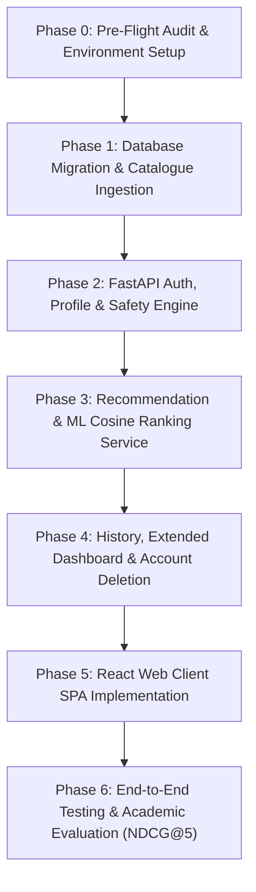

# PLAN.md — Implementation Roadmap & Delivery Plan

**Project:** Personalized AI-Driven Fitness and Workout Recommendation System Using Machine Learning  
**Version:** 1.0.0  
**Status:** PROPOSED Implementation Baseline  
**Authority Sources:** [SRS.md](../SRS.md) §14, §15; [PRD.md](../PRD.md) §16, §21  

---

## 1. Implementation Principles & Definition of Done

### 1.1 Engineering Principles
1. **Safety & Integrity First:** Safety holds and input validation are built and tested before the machine learning ranker is implemented.
2. **Deterministic Reproducibility:** Every algorithm, filter, and vector calculation must be unit-tested to guarantee deterministic behavior.
3. **No Premature Implementation:** Application development proceeds phase-by-phase; no phase starts until its prerequisite gates are verified.
4. **Maintained Traceability:** Every code module and test must trace directly back to functional requirements in [SRS.md](../SRS.md).

### 1.2 Definition of Done (DoD)
A task or phase is considered **Done** only when:
- Code is implemented according to approved architectural and database specifications.
- Automated tests pass with zero hard-constraint violations (100% pass rate on mandatory acceptance tests).
- Error handling returns standard envelopes without leaking stack traces or internal secrets.
- Documentation and schema migrations are updated and aligned.

---

## 2. Project Implementation Phases

---

## 3. Phase Breakdown & Task Inventory

### Phase 0: Pre-Flight Audit & Environment Setup
- **Objective:** Establish the local development environments, git repository controls, and Supabase project.
- **Tasks:**
  - `TASK-P0-01`: Run the mandatory 14-document audit per [MASTER-DEVELOPMENT-PROMPT.md](../documentation/MASTER-DEVELOPMENT-PROMPT.md).
  - `TASK-P0-02`: Provision Supabase hosted project; retrieve URL, Anon Key, Service Role Key, and JWT Secret.
  - `TASK-P0-03`: Create `backend/` scaffolding with Python virtual environment, dependencies (`fastapi`, `uvicorn`, `pydantic`, `sqlalchemy`, `asyncpg`, `scikit-learn`, `numpy`, `pytest`, `supabase`), and `.env.example`.
  - `TASK-P0-04`: Create `frontend/` scaffolding with React 18, Vite, Tailwind CSS, `@supabase/supabase-js`, and `.env.example`.
- **Validation Gate:** `GET /api/health` returns HTTP 200; React starter loads on `localhost:5173`.

---

### Phase 1: Database Migration & Catalogue Ingestion
- **Objective:** Apply PostgreSQL DDL, configure RLS, and curate the ~30 approved session catalogue.
- **Tasks:**
  - `TASK-P1-01`: Apply DDL migrations creating tables: `profiles`, `exercises`, `workout_sessions`, `session_exercises`, `exercise_alternatives`, `workout_history`.
  - `TASK-P1-02`: Apply Row Level Security (RLS) policies for user data isolation and public catalogue reading.
  - `TASK-P1-03`: Develop Free Exercise DB ingestion script (`scripts/ingest_catalogue.py`) to import raw exercise data.
  - `TASK-P1-04`: Implement curation and automated validation CLI (`scripts/validate_catalogue.py`) checking schema, sequence, rest intervals, equipment, and duration.
  - `TASK-P1-05`: Seed 30 complete workout sessions across the 6 supported goals (at least 5 per goal) and mark status as `'approved'`.
- **Validation Gate:** Database contains >=30 approved sessions and >=100 exercises passing automated schema validation (`DATA-01` through `DATA-14`).

---

### Phase 2: FastAPI Auth, Profile & Safety Engine
- **Objective:** Build token validation, profile CRUD, and mandatory backend safety hold enforcement.
- **Tasks:**
  - `TASK-P2-01`: Implement Supabase JWT verification middleware (`app.core.auth`) deriving `user_id` strictly from token claims (`AUTH-05` to `AUTH-07`).
  - `TASK-P2-02`: Implement `GET /api/profile` and `PUT /api/profile` with Pydantic validation for the 6 goals, 3 levels, 10 equipment items, and duration range 5–180 minutes (`PROF-01` to `PROF-13`).
  - `TASK-P2-03`: Implement Physical Screening logic (`SAFE-01` to `SAFE-04`).
  - `TASK-P2-04`: Implement backend Safety Hold interceptor (`SAFE-05` to `SAFE-12`) returning HTTP 409 `SAFETY_HOLD_ACTIVE` on active injuries or ongoing physical limitations.
- **Validation Gate:** Unit tests confirm active safety hold blocks recommendation generation regardless of input modifications (`AT-08`, `AT-09`).

---

### Phase 3: Recommendation & ML Cosine Ranking Service
- **Objective:** Implement deterministic hard filtering, feature vector construction, content-based Cosine Similarity, and tie-breaking.
- **Tasks:**
  - `TASK-P3-01`: Implement Hard Filter Engine (`REC-04` to `REC-06`, `EQ-01` to `EQ-07`):
    - Difficulty filter (Beginner $\to$ Beginner; Intermediate $\to$ Beg+Int; Advanced $\to$ All).
    - Equipment availability checker (including `exercise_alternatives` resolution).
    - Verified duration check.
  - `TASK-P3-02`: Implement Feature Vector Builder encoding goals, categories, muscles, and normalized duration (`Q-001`).
  - `TASK-P3-03`: Implement Cosine Similarity calculation with zero-vector safeguard and non-finite number sanitization (`REC-11`).
  - `TASK-P3-04`: Implement Ranking & Explanation Engine:
    - Tier 1: Primary goal match.
    - Tier 2: Secondary goal match.
    - Tie-break: Deterministic sort by `workout_id`.
    - Generate transparent explanation strings (`REC-16`).
    - Cap at top 5 items; handle 0-item empty responses cleanly with HTTP 200 (`REC-13` to `REC-15`).
  - `TASK-P3-05`: Implement Benchmark Baseline Ranker (Hard filters + heuristic primary/secondary goal sorting).
- **Validation Gate:** Unit and acceptance tests pass for `AT-01` through `AT-07`, `AT-11` through `AT-16`.

---

### Phase 4: History, Extended Dashboard & Account Deletion
- **Objective:** Provide explicit completion logging, analytics aggregation, and secure account deletion.
- **Tasks:**
  - `TASK-P4-01`: Implement `POST /api/history` with idempotency key / duplicate submission protection (`HIST-01` to `HIST-04`).
  - `TASK-P4-02`: Implement `GET /api/history` ordered by `completed_at DESC` (`HIST-05` to `HIST-08`).
  - `TASK-P4-03`: Implement `GET /api/dashboard` aggregating total completions, recent activity, weekly trend buckets, and goal-wise counts (`DASH-01` to `DASH-07`).
  - `TASK-P4-04`: Implement `DELETE /api/account` calling Supabase Admin API to delete auth user, cascading to profile and history (`DEL-01` to `DEL-07`).
  - `TASK-P4-05`: Implement `GET /api/nutrition` serving curated non-medical guidance modules (`NUT-01` to `NUT-07`).
- **Validation Gate:** Tests verify duplicate completion prevention (`AT-20`), dashboard metric accuracy (`AT-21`), and account deletion privacy (`AT-22`).

---

### Phase 5: React Web Client SPA Implementation
- **Objective:** Build the responsive user interface reflecting approved design specifications.
- **Tasks:**
  - `TASK-P5-00`: Implement Public Landing Page with Hero Section, recommendation-process overview, value props, and navigation CTAs per `DESIGN.md` §3.1 (`FEAT-14`).
  - `TASK-P5-01`: Implement Authentication UI (Login, Signup, Logout) with Supabase Auth client.
  - `TASK-P5-02`: Implement Profile Setup & Safety Screening form with validation cues.
  - `TASK-P5-03`: Implement Safety Hold modal / alert banner displaying non-diagnostic guidance and resumption controls.
  - `TASK-P5-04`: Implement Recommendations View with workout cards, match explanations, duration warnings, and empty states.
  - `TASK-P5-05`: Implement Session Detail & Execution modal with exercise sequences, sets/reps, rest timer, and explicit completion button.
  - `TASK-P5-06`: Implement Extended Dashboard view with summary cards, weekly trends chart, and goal-wise completion list.
  - `TASK-P5-07`: Implement Account Settings view with deliberate Account Deletion dialog.
  - `TASK-P5-08`: Implement General Nutrition Guidance view.
- **Validation Gate:** End-to-end interactive user journeys operate seamlessly without console errors.

---

### Phase 6: End-to-End Testing & Academic Evaluation (NDCG@5)
- **Objective:** Execute all 26 mandatory acceptance tests and evaluate Cosine ranking vs. baseline.
- **Tasks:**
  - `TASK-P6-01`: Construct test suite of 10 representative synthetic profiles covering edge cases (safety hold, missing equipment, all difficulty levels, empty matches).
  - `TASK-P6-02`: Generate human relevance labels (0 to 3 scale) for profile-session pairs.
  - `TASK-P6-03`: Compute NDCG@5 for Cosine Similarity vs. Baseline; document comparative findings.
  - `TASK-P6-04`: Execute latency benchmarking measuring p50 and p95 pipeline latency across 100 requests.
  - `TASK-P6-05`: Final capstone evaluation report generation (`evaluation_report.md`).
- **Validation Gate:** 100% pass on acceptance tests `AT-01` through `AT-26`; measured p95 pipeline latency < 1.0 second.

---

## 4. Requirements Traceability Matrix

| Requirement IDs | Component / Module | Implementation Tasks | Verification Test Gate |
|---|---|---|---|
| `AUTH-01` to `AUTH-08` | Supabase Auth & JWT Middleware | `TASK-P2-01`, `TASK-P5-01` | `AT-17`, `AT-18` |
| `PROF-01` to `PROF-13` | Profile Service & Validation | `TASK-P2-02`, `TASK-P5-02` | `AT-05` |
| `SAFE-01` to `SAFE-12` | Safety Screening & Hold Engine | `TASK-P2-03`, `TASK-P2-04`, `TASK-P5-03` | `AT-08`, `AT-09`, `AT-10` |
| `DATA-01` to `DATA-14` | Ingestion & Curation Scripts | `TASK-P1-03`, `TASK-P1-04`, `TASK-P1-05` | `AT-06`, `AT-07` |
| `EQ-01` to `EQ-07` | Equipment Matcher & Alternatives | `TASK-P3-01` | `AT-04`, `AT-05` |
| `REC-01` to `REC-20` | Recommendation & ML Ranker | `TASK-P3-01` to `TASK-P3-04`, `TASK-P5-04` | `AT-01` to `AT-03`, `AT-11` to `AT-16` |
| `HIST-01` to `HIST-08` | Workout History Service | `TASK-P4-01`, `TASK-P4-02`, `TASK-P5-05` | `AT-19`, `AT-20` |
| `DASH-01` to `DASH-07` | Dashboard Aggregator | `TASK-P4-03`, `TASK-P5-06` | `AT-21` |
| `NUT-01` to `NUT-07` | Nutrition Guidance Service | `TASK-P4-05`, `TASK-P5-08` | `AT-23` |
| `DEL-01` to `DEL-07` | Account Lifecycle Manager | `TASK-P4-04`, `TASK-P5-07` | `AT-22` |
| `FEAT-14` (SRS §2.2) | Public Landing & Hero UI | `TASK-P5-00` | UI Review Gate |
| `NFR-PERF-01` to `03` | Performance Benchmark | `TASK-P6-04` | `EV-08` |
